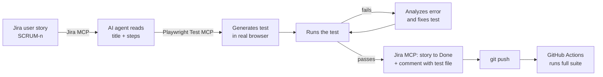
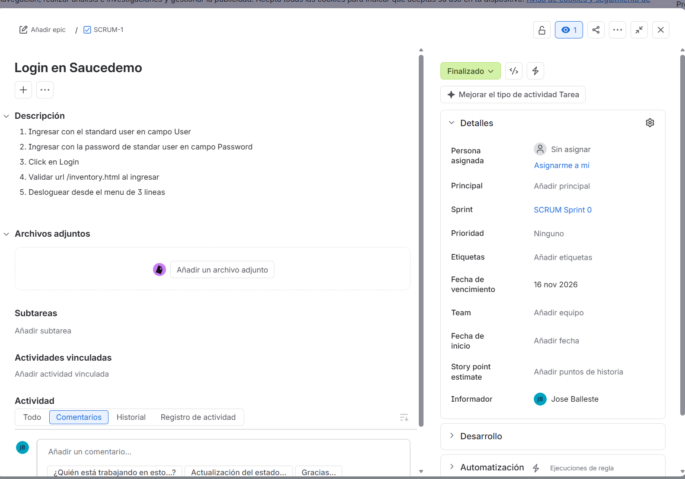

# E-commerce AI-assisted QA with Playwright

[](https://github.com/Proctosis0/ecommerce-ai-qa-playwright/actions/workflows/playwright.yml)

**[▶ Live test report](https://proctosis0.github.io/ecommerce-ai-qa-playwright/)** (latest run on `main`) · **[Test plan](docs/test-plan.md)** · **[Traceability matrix](docs/traceability-matrix.md)** · **[Test summary report](docs/test-summary-report.md)** · **[Bug reports](https://github.com/Proctosis0/ecommerce-ai-qa-playwright/issues)**

## At a glance

| Test cases designed | Automated tests | Passing | Defects found | Unexpected failures | Jira epics / stories |
| :---: | :---: | :---: | :---: | :---: | :---: |
| 33 | 30 | 22 | 8 (4 High) | 0 | 2 / 7 |

End-to-end and API test automation for the [SauceDemo](https://www.saucedemo.com) store, built with **Playwright + TypeScript** and an **AI-assisted workflow that connects Jira, Playwright and GitHub**.

A user story is read from Jira, an AI agent turns it into a Playwright test using the real browser, the test runs, and the Jira story is moved to *Done* with a comment, all from one reusable prompt. Every push runs the full suite in GitHub Actions.

## Highlights

- **Jira → test → Jira loop** driven by MCP servers (Jira MCP + Playwright Test MCP) and AI coding agents (Claude Code / OpenCode).
- **Page Object Model** in TypeScript, injected into tests through **Playwright fixtures**.
- **UI and API coverage**, including a cross-check of the cart price against a REST API.
- **REST API suite with contract validation**: authentication, full CRUD, token permissions and input validation on Restful-Booker, with responses checked against **Zod** schemas.
- **Data-driven tests**: checkout form validations run from a table of cases in `data/test-data.ts`.
- **8 defects found and documented** (store + APIs), each with a GitHub Issue (steps, evidence, severity, priority) and a failing-by-design test (see [Defects found](#defects-found)).
- **Full QA cycle documented**: [test plan](docs/test-plan.md) → test cases → execution → [summary report with go/no-go recommendation](docs/test-summary-report.md).
- **Traceability like a real team**: Jira epics → stories with acceptance criteria → test cases; defects as Jira *Bug* items linked to their story. Every test carries its Jira key as a Playwright tag (`@SCRUM-n`), so any story can be re-tested on its own. Details in the [traceability matrix](docs/traceability-matrix.md).
- **Login once, reuse the session** (`storageState` + setup project) so flow tests start already logged in.
- **CI on every push** with GitHub Actions; the HTML report is published to **GitHub Pages**.
- Centralized test data, credentials from environment variables, `data-test` based selectors.

## How the AI workflow works



1. A story is written in Jira with the steps to validate (e.g. `SCRUM-1: Login en Saucedemo`).
2. The reusable prompt in [`specs/SCRUM-1-login-saucedemo.txt`](specs/SCRUM-1-login-saucedemo.txt) tells the agent to fetch the story through the **Jira MCP**.
3. The **Playwright test generator agent** ([`.claude/agents/`](.claude/agents)) walks through the steps in a real browser, using [`tests/seed.spec.ts`](tests/seed.spec.ts) as the starting point, and writes the test with real selectors.
4. The test is executed; if it fails, the agent analyzes the error and fixes it. If it cannot, the story is **not** moved.
5. When it passes, the story is moved to **Done** and a comment with the test file, result and date is added in Jira.
6. I always review and refactor the AI output before committing (Page Objects, fixtures, test data).

**Result in Jira:** story SCRUM-1 moved to *Finalizado* (Done) after its test passed.



## Test coverage

| Area | Spec | What it validates |
| --- | --- | --- |
| Login | `tests/login/login.spec.ts` | Successful login and access to the inventory |
| Login | `tests/login/locked-user.spec.ts` | Locked user is rejected with the right error message |
| Login (Jira) | `tests/login/SCRUM-1-login-saucedemo.spec.ts` | Login + logout, generated from Jira story SCRUM-1 |
| Products | `tests/productos/select-product.spec.ts` | Product detail, price and add to cart |
| Cart | `tests/carrito/verify-cart.spec.ts` | Cart contents, product name and price |
| Cart (Jira) | `tests/carrito/SCRUM-5-agregar-quitar-productos.spec.ts` | Add two products, remove them from the cart and from the product list, cart badge updates; generated from Jira story SCRUM-5 |
| Checkout (Jira) | `tests/checkout/SCRUM-6-checkout-validaciones.spec.ts` | Data-driven required-field errors (4 cases) and a full purchase checking subtotal, 8% tax and total; Jira story SCRUM-6 |
| Defects (Jira) | `tests/bugs/SCRUM-7-problem-user.spec.ts` | Three `problem_user` defects (images, sorting, checkout last name) documented as expected failures; Jira story SCRUM-7 |
| E2E | `tests/e2e/compra-completa.spec.ts` | Login → add product → cart → price check against API → logout |
| API | `tests/api/producto.spec.ts` | Price API: valid product and non-existent product |
| API | `tests/api/booking/booking.spec.ts` | Restful-Booker: auth, CRUD, `403` without token, input validation, Zod contract (13 tests) |

## Defects found

| ID | Area | Expected | Actual |
| --- | --- | --- | --- |
| BUG-01 | Products (`problem_user`) | Each product shows its own image | All 6 products show the same image |
| BUG-02 | Products (`problem_user`) | "Price (low to high)" sorts the list | The order does not change |
| BUG-03 | Checkout (`problem_user`) | Last name stays in "Last Name" | It is written into "First Name"; checkout cannot continue |
| BUG-04 | Price API | Unknown product returns `404` | Returns `200` + `{ "precio": 0 }` |
| BUG-05 | Booking API | Invalid login returns `401` | Returns `200` + `{ "reason": "Bad credentials" }` |
| BUG-06 | Booking API | Incomplete booking returns `400` | Returns `500 Internal Server Error` |
| BUG-07 | Booking API | Negative price / checkout before checkin rejected | Accepted with `200`, booking created |
| BUG-08 | Booking API | Successful delete returns `200`/`204` | Returns `201 Created` |

Each defect has a test that asserts the **correct** behavior, marked with `test.fail()` and a `bug` annotation: the suite stays green while the defect exists and the report lists every bug. To make sure those tests fail *because of the bug* (and not because of a broken test), they were also run against `standard_user`, where all of them pass. Full details in the [defect log](docs/traceability-matrix.md#defect-log).

### BUG-04 in detail: price API

`POST https://cursotesting.com.ar:3000/producto/`

| Request body | Expected | Actual |
| --- | --- | --- |
| `{ "nombre": "Sauce Labs Backpack" }` | `200` + `{ "precio": 29.99 }` | ✅ `200` + `{ "precio": 29.99 }` |
| `{ "nombre": "Producto Inexistente" }` | `404` (or an error body) | ❌ `200` + `{ "precio": 0 }` |

Returning a price of `0` for an unknown product could let a client treat a missing product as free. When the API is fixed, the test will be reported as "unexpectedly passed", which is the signal to remove the marker.

## Tech stack

- **Playwright Test** + **TypeScript** (strict mode)
- **Zod** for API contract validation
- **Page Object Model** + **fixtures** (`test.extend`)
- **MCP servers**: Jira MCP, Playwright Test MCP
- **AI coding agents**: Claude Code, OpenCode
- **Jira** (Scrum project) for user stories
- **GitHub Actions** (official Playwright container)
- **dotenv** for local credentials

## Project structure

```
data/test-data.ts         Test data: users (from env), products, routes, checkout cases, API URL
data/auth.ts              Path of the saved login session
tests/auth.setup.ts       Logs in once and saves the session (storageState)
tests/fixtures.ts         test.extend() that injects the Page Objects
tests/pages/              Page Objects: BasePage, LoginPage, ProductsPage, CartPage, CheckoutPage
tests/api/                Price API helper and tests
tests/api/booking/        Restful-Booker client, Zod schemas and API suite
tests/e2e/                Full purchase flow
tests/login|productos|carrito|checkout/   Feature tests
tests/bugs/               Documented defects (expected failures)
docs/                     Test plan, traceability matrix, defect log, summary report, bug evidence
tests/seed.spec.ts        Seed used by the AI test generator
specs/                    Jira-driven prompts and test plans
.claude/agents/           Playwright planner / generator / healer agents
.github/workflows/        CI pipeline
```

## Running the tests

**Requirements:** Node.js LTS.

```bash
npm install
npx playwright install chromium
npm test
```

| Script | Description |
| --- | --- |
| `npm test` | Full suite (Chromium) |
| `npm run test:e2e` | E2E flow only |
| `npm run test:api` | API tests only |
| `npm run test:login` / `test:productos` / `test:carrito` / `test:checkout` | One feature area |
| `npm run test:bugs` | Documented defects only |
| `npx playwright test --grep "@SCRUM-6"` | All tests of one Jira story (use the story key) |
| `npm run test:headed` | Run with a visible browser |
| `npm run test:ui` | Playwright UI mode |
| `npm run report` | Open the last HTML report |
| `npm run codegen` | Record a new flow with Playwright codegen |

### Environment variables

Credentials are optional; if not set, the public SauceDemo users are used.

```bash
cp .env.example .env
```

| Variable | Default |
| --- | --- |
| `SAUCE_USER` | `standard_user` |
| `SAUCE_PASSWORD` | `secret_sauce` |
| `SAUCE_LOCKED_USER` | `locked_out_user` |
| `SAUCE_LOCKED_PASSWORD` | `secret_sauce` |
| `SAUCE_PROBLEM_USER` | `problem_user` |
| `SAUCE_PROBLEM_PASSWORD` | `secret_sauce` |
| `BOOKING_API_URL` | `https://restful-booker.herokuapp.com` |
| `BOOKING_API_USER` / `BOOKING_API_PASSWORD` | `admin` / `password123` (public demo) |

`.env` and the MCP configuration (`.mcp.json`, which holds the Jira and GitHub tokens) are git-ignored and never committed. In CI the variables come from the workflow or repository secrets.

## Design decisions

- **Selectors**: `getByTestId()` mapped to SauceDemo's `data-test` attribute (`use.testIdAttribute`), the most stable option on this site.
- **Web-first assertions**: auto-retrying `expect(locator)` instead of reading values once, to avoid flaky tests.
- **Descriptive assertion messages** so a failure explains what was expected without reading the code.
- **Single source of test data**: base URL only in `playwright.config.ts`; products and API URL in `data/test-data.ts`.
- **Video and traces only when needed**: `video: 'retain-on-failure'`, `trace: 'on-first-retry'`.
- **Login once**: a `setup` project logs in and saves the session; the `chromium-logged-in` project (products, cart, checkout) reuses it, while login tests and other users run in a clean `chromium` project.
- **Self-cleaning API tests**: a fixture creates each booking and deletes it after the test, so results never depend on the state of a shared public API.
- **Contract as code**: Zod schemas use `.strict()`, so an unexpected or missing field breaks the test instead of passing silently.
- **Data-driven over copy-paste**: one checkout test body runs for every invalid case in `data/test-data.ts`; adding a case is one line of data.

## Roadmap

- [x] Cart add/remove flow through the AI loop (SCRUM-5)
- [x] Checkout validations, data-driven (SCRUM-6)
- [x] `problem_user` defects documented (SCRUM-7)
- [x] HTML report published to GitHub Pages
- [ ] Product sorting for `standard_user` through the AI loop
- [ ] Visual and accessibility checks
- [ ] Performance smoke test with JMeter

## Author

**Jose Balleste**, QA Analyst with 5 years of experience testing banking systems (Core Banking, CRM, digital channels), now focused on test automation with Playwright and AI.

[LinkedIn](https://linkedin.com/in/joseballeste)
