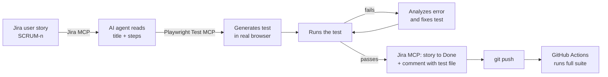

# E-commerce AI-assisted QA with Playwright

[](https://github.com/Proctosis0/ecommerce-ai-qa-playwright/actions/workflows/playwright.yml)

End-to-end and API test automation for the [SauceDemo](https://www.saucedemo.com) store, built with **Playwright + TypeScript** and an **AI-assisted workflow that connects Jira, Playwright and GitHub**.

A user story is read from Jira, an AI agent turns it into a Playwright test using the real browser, the test runs, and the Jira story is moved to *Done* with a comment, all from one reusable prompt. Every push runs the full suite in GitHub Actions.

## Highlights

- **Jira → test → Jira loop** driven by MCP servers (Jira MCP + Playwright Test MCP) and AI coding agents (Claude Code / OpenCode).
- **Page Object Model** in TypeScript, injected into tests through **Playwright fixtures**.
- **UI and API coverage**, including a cross-check of the cart price against a REST API.
- **A real defect found and documented**: the price API returns `200 OK` for products that do not exist (see [Known bug](#known-bug-found-by-the-api-tests)).
- **CI on every push** with GitHub Actions, HTML report uploaded as an artifact.
- Centralized test data, credentials from environment variables, `data-test` based selectors.

## How the AI workflow works



1. A story is written in Jira with the steps to validate (e.g. `SCRUM-1: Login en Saucedemo`).
2. The reusable prompt in [`specs/SCRUM-1-login-saucedemo.txt`](specs/SCRUM-1-login-saucedemo.txt) tells the agent to fetch the story through the **Jira MCP**.
3. The **Playwright test generator agent** ([`.claude/agents/`](.claude/agents)) walks through the steps in a real browser, using [`tests/seed.spec.ts`](tests/seed.spec.ts) as the starting point, and writes the test with real selectors.
4. The test is executed; if it fails, the agent analyzes the error and fixes it. If it cannot, the story is **not** moved.
5. When it passes, the story is moved to **Done** and a comment with the test file, result and date is added in Jira.
6. I always review and refactor the AI output before committing (Page Objects, fixtures, test data).

**Result in Jira:** story SCRUM-1 moved to *Finalizado* (Done) after its test passed.


## Test coverage

| Area | Spec | What it validates |
| --- | --- | --- |
| Login | `tests/login/login.spec.ts` | Successful login and access to the inventory |
| Login | `tests/login/locked-user.spec.ts` | Locked user is rejected with the right error message |
| Login (Jira) | `tests/login/SCRUM-1-login-saucedemo.spec.ts` | Login + logout, generated from Jira story SCRUM-1 |
| Products | `tests/productos/select-product.spec.ts` | Product detail, price and add to cart |
| Cart | `tests/carrito/verify-cart.spec.ts` | Cart contents, product name and price |
| Cart (Jira) | `tests/carrito/SCRUM-5-agregar-quitar-productos.spec.ts` | Add two products, remove them from the cart and from the product list, cart badge updates; generated from Jira story SCRUM-5 |
| E2E | `tests/e2e/compra-completa.spec.ts` | Login → add product → cart → price check against API → logout |
| API | `tests/api/producto.spec.ts` | Price API: valid product and non-existent product |

## Known bug found by the API tests

`POST https://cursotesting.com.ar:3000/producto/`

| Request body | Expected | Actual |
| --- | --- | --- |
| `{ "nombre": "Sauce Labs Backpack" }` | `200` + `{ "precio": 29.99 }` | ✅ `200` + `{ "precio": 29.99 }` |
| `{ "nombre": "Producto Inexistente" }` | `404` (or an error body) | ❌ `200` + `{ "precio": 0 }` |

Returning a price of `0` for an unknown product could let a client treat a missing product as free. The negative test asserts the **correct** behavior and is marked with `test.fail()` plus a `bug` annotation, so the suite stays green while the defect is visible in the report. When the API is fixed, that test will be reported as "unexpectedly passed", which is the signal to remove the marker.

## Tech stack

- **Playwright Test** + **TypeScript** (strict mode)
- **Page Object Model** + **fixtures** (`test.extend`)
- **MCP servers**: Jira MCP, Playwright Test MCP
- **AI coding agents**: Claude Code, OpenCode
- **Jira** (Scrum project) for user stories
- **GitHub Actions** (official Playwright container)
- **dotenv** for local credentials

## Project structure

```
data/test-data.ts         Test data: users (from env), products, routes, API URL
tests/fixtures.ts         test.extend() that injects loginPage, productsPage, cartPage
tests/pages/              Page Objects: BasePage, LoginPage, ProductsPage, CartPage
tests/api/                API helper (productoApi.ts) and API tests
tests/e2e/                Full purchase flow
tests/login|productos|carrito/   Feature tests
tests/seed.spec.ts        Seed used by the AI test generator
specs/                    Jira-driven prompts and test plans
.claude/agents/           Playwright planner / generator / healer agents
.github/workflows/        CI pipeline
```

## Running the tests

**Requirements:** Node.js LTS.

```bash
npm install
npx playwright install chromium
npm test
```

| Script | Description |
| --- | --- |
| `npm test` | Full suite (Chromium) |
| `npm run test:e2e` | E2E flow only |
| `npm run test:api` | API tests only |
| `npm run test:login` / `test:productos` / `test:carrito` | One feature area |
| `npm run test:headed` | Run with a visible browser |
| `npm run test:ui` | Playwright UI mode |
| `npm run report` | Open the last HTML report |
| `npm run codegen` | Record a new flow with Playwright codegen |

### Environment variables

Credentials are optional; if not set, the public SauceDemo users are used.

```bash
cp .env.example .env
```

| Variable | Default |
| --- | --- |
| `SAUCE_USER` | `standard_user` |
| `SAUCE_PASSWORD` | `secret_sauce` |
| `SAUCE_LOCKED_USER` | `locked_out_user` |
| `SAUCE_LOCKED_PASSWORD` | `secret_sauce` |

`.env` and the MCP configuration (`.mcp.json`, which holds the Jira and GitHub tokens) are git-ignored and never committed. In CI the variables come from the workflow or repository secrets.

## Design decisions

- **Selectors**: `getByTestId()` mapped to SauceDemo's `data-test` attribute (`use.testIdAttribute`), the most stable option on this site.
- **Web-first assertions**: auto-retrying `expect(locator)` instead of reading values once, to avoid flaky tests.
- **Descriptive assertion messages** so a failure explains what was expected without reading the code.
- **Single source of test data**: base URL only in `playwright.config.ts`; products and API URL in `data/test-data.ts`.
- **Video and traces only when needed**: `video: 'retain-on-failure'`, `trace: 'on-first-retry'`.

## Roadmap

- [x] Cart add/remove flow through the AI loop (SCRUM-5)
- [ ] More Jira stories through the AI loop (checkout form validation, product sorting)
- [ ] Visual and accessibility checks
- [ ] Performance smoke test with JMeter

## Author

**Jose Balleste**, QA Analyst with 5 years of experience testing banking systems (Core Banking, CRM, digital channels), now focused on test automation with Playwright and AI.

[LinkedIn](https://linkedin.com/in/joseballeste)
